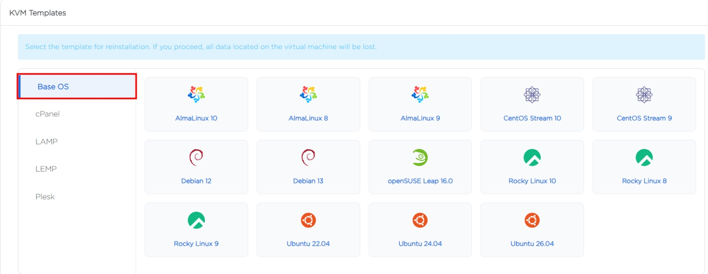
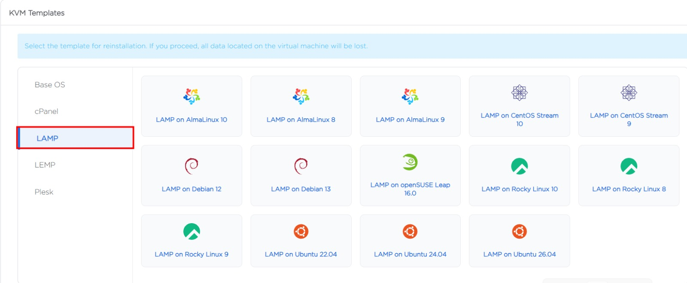
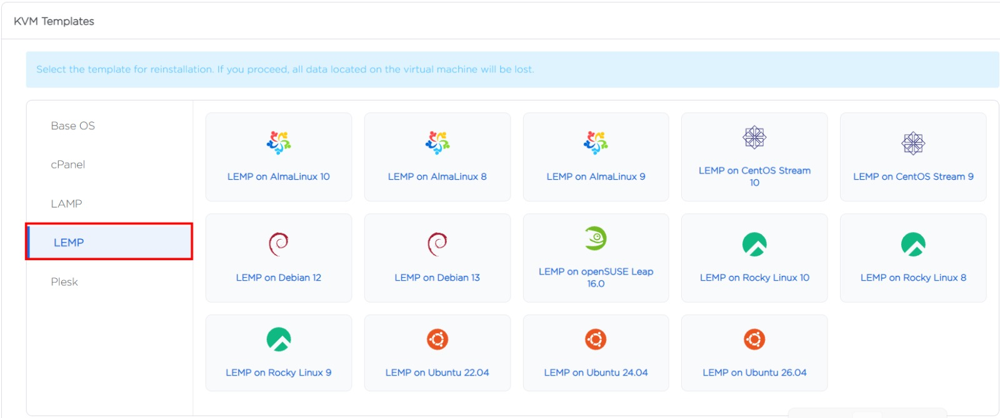
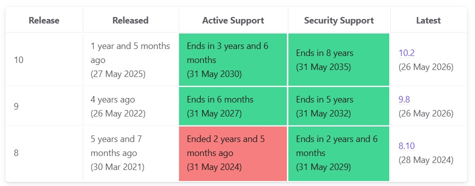
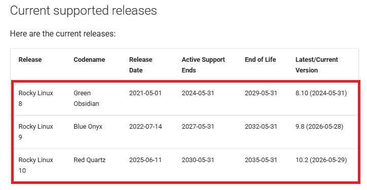
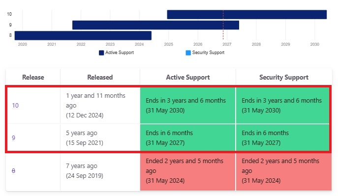
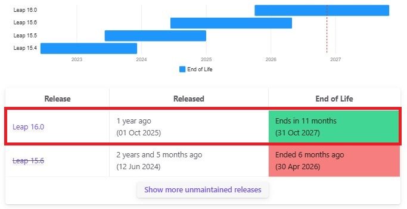

<!--
CATATAN EDITOR (hapus seluruh blok komentar ini sebelum artikel dipublikasikan)

Artikel  : Informasi Lengkap OS Linux yang Disediakan oleh Layanan VPS CloudKilat
URL      : https://kb.cloudkilat.id/kilat-vm-2-0/informasi-lengkap-os-linux-yang-disediakan-oleh-layanan-vps-cloud-kilat
Data per : 13 November 2026. Tanggal rilis, kernel, dan masa dukungan dicek ke situs resmi tiap distro (lihat bagian Sumber).

DAFTAR FOTO (simpan di folder images/ dengan nama file berikut)

| Gambar   | Nama file                                | Isi foto                                                                                   | Penanda merah                                                     |
|----------|------------------------------------------|--------------------------------------------------------------------------------------------|-------------------------------------------------------------------|
| Gambar 1 | images/gambar-01-template-base-os.png     | Panel KVM Templates di tab Reinstallation, tab Base OS aktif, 14 template terlihat          | Kotak merah pada tab Base OS                                      |
| Gambar 2 | images/gambar-02-template-lamp.png        | Panel KVM Templates, tab LAMP aktif                                                         | Kotak merah pada tab LAMP                                         |
| Gambar 3 | images/gambar-03-template-lemp.png        | Panel KVM Templates, tab LEMP aktif                                                         | Kotak merah pada tab LEMP                                         |
| Gambar 4 | images/gambar-04-siklus-almalinux.png     | Tabel rilis AlmaLinux OS 10, 9, dan 8 di https://wiki.almalinux.org/release-notes/          | Kotak merah pada keterangan active support dan security support   |
| Gambar 5 | images/gambar-05-siklus-ubuntu.png        | Tabel/grafik siklus rilis LTS di https://ubuntu.com/about/release-cycle                     | Kotak merah pada baris 26.04 LTS, 24.04 LTS, dan 22.04 LTS        |
| Gambar 6 | images/gambar-06-siklus-debian.png        | Daftar rilis di https://www.debian.org/releases/                                            | Kotak merah pada Debian 13 (trixie) dan Debian 12 (bookworm)      |
| Gambar 7 | images/gambar-07-siklus-rocky-linux.png   | Tabel "Current supported releases" di https://docs.rockylinux.org/releases/                | Kotak merah pada baris Rocky Linux 10, 9, dan 8                   |
| Gambar 8 | images/gambar-08-siklus-centos-stream.png | Bagian CentOS Stream 10 dan 9 di https://www.centos.org/download/                           | Kotak merah pada tanggal End-of-life                              |
| Gambar 9 | images/gambar-09-siklus-opensuse-leap.png | Daftar masa pemeliharaan Leap di https://en.opensuse.org/Lifetime                           | Kotak merah pada baris openSUSE Leap 16.0                         |

STANDAR GAMBAR
- Kotak, tulisan, dan penanda angka wajib berwarna merah.
- Sensor email, nama akun, domain non-internal, dan IP publik. Untuk Gambar 1 sampai 3, crop pada area panel
  KVM Templates saja agar nama akun di header Portal Client tidak ikut terlihat.
- Keterangan gambar memakai format "Gambar N: keterangan" dengan nomor berurutan.

CATATAN LAIN
- Kotak "Butuh bantuan lebih lanjut?" sudah tampil otomatis dari template situs. Bagian H2 dengan judul yang sama
  di akhir artikel ini mengikuti standar KB; hapus salah satunya jika tampilan menjadi ganda.
-->

# Informasi Lengkap OS Linux yang Disediakan oleh Layanan VPS CloudKilat

## Pendahuluan

Halo, Kawan Belajar CloudKilat!

Sistem operasi (OS) menentukan aplikasi apa saja yang bisa berjalan di VPS Anda dan berapa lama server tersebut tetap mendapat pembaruan keamanan. Karena itu, memilih distribusi dan versi yang tepat sebaiknya dilakukan sejak awal.

Artikel ini merangkum seluruh OS Linux yang tersedia pada layanan Kilat VPS (Kilat VM 2.0), lengkap dengan tanggal rilis, kernel bawaan, masa dukungan, serta kelebihan dan kekurangan setiap versi. Daftar OS di bawah berlaku untuk template Base OS, LAMP, dan LEMP. Data diperbarui per 13 November 2026.

## Pilihan OS di Kilat VPS

Template OS dapat dipilih melalui tab Reinstallation pada halaman Manage layanan Kilat VM 2.0 di Portal Client. Langkah lengkapnya dapat dilihat pada artikel [Panduan Praktis: Cara Reinstall Layanan Kilat VM 2.0 Melalui Portal Client](https://kb.cloudkilat.id/pengelolaan-layanan/panduan-praktis-cara-reinstall-layanan-kilat-vm-2-0-melalui-portal-client).

<!-- FOTO Gambar 1
File    : images/gambar-01-template-base-os.png
Isi     : Panel KVM Templates di tab Reinstallation (Portal Client > Services > Kilat VM 2.0 > Manage > Reinstallation),
          tab Base OS aktif, menampilkan 14 template: AlmaLinux 8/9/10, CentOS Stream 9/10, Debian 12/13,
          openSUSE Leap 16.0, Rocky Linux 8/9/10, Ubuntu 22.04/24.04/26.04.
Penanda : kotak merah pada tab Base OS.
Sensor  : crop area panel saja; sensor nama akun, email, domain, atau IP jika ikut terlihat. -->

*Gambar 1: Daftar template Base OS pada panel KVM Templates*

Template Base OS berisi sistem operasi saja, sedangkan template LAMP dan LEMP sudah menyertakan paket web server, database, dan PHP. LAMP memakai Apache sebagai web server, sedangkan LEMP memakai Nginx. Perbedaan keduanya dibahas pada artikel [Perbedaan LAMP dan LEMP](https://kb.cloudkilat.id/kilat-vm-2-0/perbedaan-lamp-dan-lemp-panduan-dasar-untuk-pengguna-cloud-kilat).

<!-- FOTO Gambar 2
File    : images/gambar-02-template-lamp.png
Isi     : Panel KVM Templates, tab LAMP aktif, menampilkan daftar template LAMP.
Penanda : kotak merah pada tab LAMP.
Sensor  : crop area panel saja. -->

*Gambar 2: Daftar template LAMP pada panel KVM Templates*

<!-- FOTO Gambar 3
File    : images/gambar-03-template-lemp.png
Isi     : Panel KVM Templates, tab LEMP aktif, menampilkan daftar template LEMP.
Penanda : kotak merah pada tab LEMP.
Sensor  : crop area panel saja. -->

*Gambar 3: Daftar template LEMP pada panel KVM Templates*

Ringkasan versi yang tersedia beserta masa dukungannya:

| Distribusi | Versi | Tanggal rilis | Kernel bawaan | Dukungan utama hingga | Dukungan keamanan hingga |
|---|---|---|---|---|---|
| AlmaLinux | 8 | 30 Maret 2021 | 4.18 | 31 Mei 2024 (sudah berakhir) | 31 Mei 2029 |
| AlmaLinux | 9 | 26 Mei 2022 | 5.14 | 31 Mei 2027 | 31 Mei 2032 |
| AlmaLinux | 10 | 27 Mei 2025 | 6.12 | 31 Mei 2030 | 31 Mei 2035 |
| Ubuntu | 22.04 LTS | 21 April 2022 | 5.15 | Mei 2027 | Mei 2032 (Ubuntu Pro) |
| Ubuntu | 24.04 LTS | 25 April 2024 | 6.8 | Mei 2029 | Mei 2034 (Ubuntu Pro) |
| Ubuntu | 26.04 LTS | 23 April 2026 | 7.0 | Mei 2031 | Mei 2036 (Ubuntu Pro) |
| Debian | 12 | 10 Juni 2023 | 6.1 | 11 Juli 2026 (sudah berakhir) | 30 Juni 2028 (LTS) |
| Debian | 13 | 9 Agustus 2025 | 6.12 | 9 Agustus 2028 | 30 Juni 2030 (LTS) |
| Rocky Linux | 8 | 1 Mei 2021 | 4.18 | 31 Mei 2024 (sudah berakhir) | 31 Mei 2029 |
| Rocky Linux | 9 | 14 Juli 2022 | 5.14 | 31 Mei 2027 | 31 Mei 2032 |
| Rocky Linux | 10 | 11 Juni 2025 | 6.12 | 31 Mei 2030 | 31 Mei 2035 |
| CentOS Stream | 9 | Desember 2021 | 5.14 | 31 Mei 2027 | 31 Mei 2027 |
| CentOS Stream | 10 | 12 Desember 2024 | 6.12 | 31 Mei 2030 | 31 Mei 2030 |
| openSUSE Leap | 16.0 | 1 Oktober 2025 | 6.12 | Oktober 2027 | Oktober 2027 |

Keterangan kolom:

- Dukungan utama adalah periode pembaruan penuh, berisi perbaikan bug dan keamanan. Istilah resminya berbeda di tiap distro: active support (AlmaLinux), general support (Rocky Linux), standard security maintenance (Ubuntu), dan regular support (Debian).
- Dukungan keamanan adalah periode lanjutan yang hanya berisi pembaruan keamanan. Pada Ubuntu, periode ini (ESM) hanya tersedia melalui Ubuntu Pro. Pada Debian, periode ini ditangani oleh tim Debian LTS.
- CentOS Stream dan openSUSE Leap tidak memiliki fase dukungan keamanan terpisah, sehingga kedua kolom berisi tanggal yang sama. Masa pemeliharaan openSUSE Leap 16.0 tercatat minimal hingga Oktober 2027.

Perubahan dibandingkan pembaruan artikel sebelumnya (16 Juli 2025):

- Ditambahkan: AlmaLinux 10, Ubuntu 26.04 LTS, Debian 13, Rocky Linux 8, Rocky Linux 10, CentOS Stream 9, CentOS Stream 10, dan openSUSE Leap 16.0.
- Tidak lagi tersedia: Ubuntu 20.04 LTS (dukungan standar berakhir 31 Mei 2025) dan Debian 11 (dukungan LTS berakhir 31 Agustus 2026). Server yang masih menjalankan kedua versi tersebut sebaiknya dipindahkan ke versi yang masih didukung.

## AlmaLinux

AlmaLinux adalah distribusi open source yang kompatibel secara biner dengan Red Hat Enterprise Linux (RHEL) dan dikelola oleh komunitas melalui AlmaLinux OS Foundation.

### AlmaLinux 8

Versi berbasis RHEL 8. Dukungan aktifnya berakhir 31 Mei 2024, sehingga saat ini AlmaLinux 8 hanya menerima pembaruan keamanan hingga 31 Mei 2029.

- Kelebihan: cocok untuk aplikasi atau panel kontrol yang masih membutuhkan basis RHEL 8, dan tetap aman dipakai karena pembaruan keamanan berjalan hingga 2029.
- Kekurangan: tidak lagi menerima pembaruan fitur, serta kernel 4.18 dan paket bawaannya sudah tertinggal dibandingkan versi 9 dan 10.

### AlmaLinux 9

Versi berbasis RHEL 9 dengan kernel 5.14.

- Kelebihan: matang, stabil, dan didukung luas oleh aplikasi pihak ketiga, dengan pembaruan keamanan hingga 31 Mei 2032.
- Kekurangan: dukungan aktif berakhir 31 Mei 2027. Setelah itu, versi ini hanya menerima pembaruan keamanan.

### AlmaLinux 10

Versi terbaru berbasis RHEL 10 dengan kernel 6.12.

- Kelebihan: masa dukungan terpanjang di keluarga AlmaLinux, yaitu pembaruan keamanan hingga 31 Mei 2035. AlmaLinux 10 juga menyediakan build x86_64_v2 untuk prosesor lama, berbeda dengan Rocky Linux 10 dan CentOS Stream 10 yang mensyaratkan prosesor x86-64-v3.
- Kekurangan: sebagian aplikasi atau panel kontrol pihak ketiga mungkin belum mendukung basis RHEL 10, jadi periksa kompatibilitasnya sebelum dipakai di server produksi.

<!-- FOTO Gambar 4
File    : images/gambar-04-siklus-almalinux.png
Isi     : Screenshot https://wiki.almalinux.org/release-notes/ bagian tabel rilis AlmaLinux OS 10, 9, dan 8.
Penanda : kotak merah pada keterangan active support dan security support masing-masing versi.
Sensor  : tidak ada data sensitif (halaman publik). -->

*Gambar 4: Tabel rilis dan masa dukungan AlmaLinux 10, 9, dan 8*

## Ubuntu

Ubuntu adalah distribusi berbasis Debian yang dikembangkan oleh Canonical. Versi LTS (Long Term Support) dirilis setiap dua tahun dan mendapat dukungan standar selama 5 tahun. Setelah itu, pembaruan keamanan dapat dilanjutkan melalui Ubuntu Pro (ESM) hingga total 10 tahun, atau hingga 15 tahun dengan Legacy add-on.

### Ubuntu 22.04 LTS (Jammy Jellyfish)

Dirilis 21 April 2022 dengan kernel 5.15.

- Kelebihan: sangat matang, dengan dokumentasi dan dukungan aplikasi pihak ketiga yang luas.
- Kekurangan: dukungan standar berakhir Mei 2027. Setelah itu, pembaruan keamanan hanya tersedia melalui Ubuntu Pro, sehingga untuk server baru lebih disarankan memilih Ubuntu 24.04 atau 26.04.

### Ubuntu 24.04 LTS (Noble Numbat)

Dirilis 25 April 2024 dengan kernel 6.8.

- Kelebihan: seimbang antara stabilitas dan kebaruan paket, dengan dukungan standar hingga Mei 2029. Banyak panduan di Basis Pengetahuan CloudKilat juga memakai versi ini, misalnya [Panduan Lengkap Install LEMP Stack (Nginx, MariaDB, PHP) di VPS Ubuntu 24.04](https://kb.cloudkilat.id/instalasi-dan-konfigurasi/panduan-lengkap-install-lemp-stack-nginx-maria-db-php-di-vps-ubuntu-24-04).
- Kekurangan: kernel dan paket bawaannya lebih lama dibandingkan Ubuntu 26.04.

### Ubuntu 26.04 LTS (Resolute Raccoon)

Dirilis 23 April 2026 dengan kernel 7.0.

- Kelebihan: kernel dan paket paling baru di antara versi LTS yang tersedia, dengan dukungan standar terpanjang hingga Mei 2031.
- Kekurangan: sebagian repositori pihak ketiga mungkin belum menyediakan paket untuk versi ini. Selain itu, sudo dan coreutils bawaan kini memakai implementasi berbasis Rust (sudo-rs dan uutils), sehingga skrip lama sebaiknya diuji terlebih dahulu.

<!-- FOTO Gambar 5
File    : images/gambar-05-siklus-ubuntu.png
Isi     : Screenshot https://ubuntu.com/about/release-cycle bagian tabel/grafik masa dukungan Ubuntu LTS.
Penanda : kotak merah pada baris 26.04 LTS, 24.04 LTS, dan 22.04 LTS (versi 20.04 tidak perlu ditandai).
Sensor  : tidak ada data sensitif (halaman publik). -->

*Gambar 5: Masa dukungan Ubuntu 26.04 LTS, 24.04 LTS, dan 22.04 LTS*

## Debian

Debian adalah distribusi komunitas yang dikenal sangat stabil dan menjadi basis Ubuntu. Setiap rilis stabil Debian mendapat sekitar 3 tahun dukungan reguler, lalu 2 tahun dukungan LTS (Long Term Support).

### Debian 12 (Bookworm)

Dirilis 10 Juni 2023 dengan kernel 6.1. Dukungan regulernya berakhir 11 Juli 2026, dan pembaruan keamanannya kini ditangani tim Debian LTS hingga 30 Juni 2028.

- Kelebihan: stabil, ringan, dan tetap menerima pembaruan keamanan hingga 30 Juni 2028.
- Kekurangan: fase LTS tidak mencakup semua paket dan arsitektur, dan Debian sendiri menyarankan pengguna beralih ke Debian 13.

### Debian 13 (Trixie)

Rilis stabil terbaru Debian, dirilis 9 Agustus 2025 dengan kernel 6.12 LTS dan APT 3.0.

- Kelebihan: paket lebih baru dengan dukungan reguler hingga 9 Agustus 2028 dan dukungan LTS hingga 30 Juni 2030.
- Kekurangan: OpenSSH di versi ini tidak lagi mendukung kunci DSA. Jika Anda masih memakai kunci SSH berjenis DSA, ganti terlebih dahulu dengan jenis yang lebih baru seperti Ed25519.

<!-- FOTO Gambar 6
File    : images/gambar-06-siklus-debian.png
Isi     : Screenshot https://www.debian.org/releases/ bagian daftar rilis yang memuat Debian 13 (trixie) dan Debian 12 (bookworm)
          beserta tanggal end of life dan LTS.
Penanda : kotak merah pada Debian 13 dan Debian 12.
Sensor  : tidak ada data sensitif (halaman publik). -->

*Gambar 6: Status dan masa dukungan Debian 13 dan Debian 12*

## Rocky Linux

Rocky Linux adalah distribusi enterprise yang kompatibel dengan RHEL dan dikembangkan oleh Rocky Enterprise Software Foundation sebagai penerus CentOS Linux.

### Rocky Linux 8 (Green Obsidian)

Versi berbasis RHEL 8 dengan kernel 4.18. Dukungan umumnya berakhir 31 Mei 2024, sehingga saat ini Rocky Linux 8 hanya menerima pembaruan keamanan hingga 31 Mei 2029.

- Kelebihan: cocok untuk aplikasi yang masih membutuhkan basis RHEL 8.
- Kekurangan: tidak lagi menerima pembaruan fitur, dan paket bawaannya sudah tertinggal dibandingkan versi 9 dan 10.

### Rocky Linux 9 (Blue Onyx)

Dirilis 14 Juli 2022 dengan kernel 5.14.

- Kelebihan: matang dan stabil, dengan pembaruan keamanan hingga 31 Mei 2032.
- Kekurangan: dukungan umum berakhir 31 Mei 2027. Setelah itu, versi ini hanya menerima pembaruan keamanan.

### Rocky Linux 10 (Red Quartz)

Dirilis 11 Juni 2025 dengan kernel 6.12.

- Kelebihan: masa dukungan terpanjang di keluarga Rocky Linux, yaitu pembaruan keamanan hingga 31 Mei 2035.
- Kekurangan: mensyaratkan prosesor x86-64-v3 dan tidak lagi menyertakan paket 32-bit. Upgrade langsung dari Rocky Linux 8 atau 9 juga tidak didukung, sehingga perpindahan versi harus melalui instalasi baru.

<!-- FOTO Gambar 7
File    : images/gambar-07-siklus-rocky-linux.png
Isi     : Screenshot https://docs.rockylinux.org/releases/ bagian tabel "Current supported releases"
          (kolom Release, Codename, Release Date, Active Support Ends, End of Life).
Penanda : kotak merah pada baris Rocky Linux 10, 9, dan 8.
Sensor  : tidak ada data sensitif (halaman publik). -->

*Gambar 7: Tabel rilis dan masa dukungan Rocky Linux 10, 9, dan 8*

## CentOS Stream

CentOS Stream berada di hulu (upstream) RHEL. Perubahan masuk ke CentOS Stream terlebih dahulu sebelum dirilis pada versi minor RHEL berikutnya. Masa hidup setiap versi CentOS Stream mengikuti berakhirnya fase full support RHEL versi yang sama.

### CentOS Stream 9

Dirilis Desember 2021 dengan kernel 5.14 dan berakhir pada 31 Mei 2027.

- Kelebihan: memberi akses lebih awal ke perubahan yang akan masuk ke RHEL 9, sehingga cocok untuk pengembangan dan pengujian.
- Kekurangan: tidak ada fase dukungan keamanan setelah 31 Mei 2027. Untuk server baru, lebih disarankan memilih CentOS Stream 10, AlmaLinux, atau Rocky Linux.

### CentOS Stream 10

Dirilis 12 Desember 2024 dengan kernel 6.12 dan berakhir pada 31 Mei 2030.

- Kelebihan: menjadi basis pengembangan RHEL 10, sehingga paketnya paling baru di keluarga RHEL.
- Kekurangan: mensyaratkan prosesor x86-64-v3, dan masa hidupnya lebih pendek dibandingkan AlmaLinux 10 dan Rocky Linux 10 yang didukung hingga 2035.

<!-- FOTO Gambar 8
File    : images/gambar-08-siklus-centos-stream.png
Isi     : Screenshot https://www.centos.org/download/ bagian CentOS Stream 10 dan CentOS Stream 9
          yang menampilkan tanggal End-of-life (2030-05-31 dan 2027-05-31).
Penanda : kotak merah pada tanggal End-of-life kedua versi.
Sensor  : tidak ada data sensitif (halaman publik). -->

*Gambar 8: Tanggal end-of-life CentOS Stream 10 dan CentOS Stream 9*

## openSUSE Leap

openSUSE Leap adalah distribusi komunitas yang dibangun dari basis SUSE Linux Enterprise. Setiap rilis minor Leap 16 dipelihara selama 24 bulan, dan pengguna diharapkan pindah ke rilis minor terbaru dalam 12 bulan setelah rilis tersebut tersedia.

### openSUSE Leap 16.0

Dirilis 1 Oktober 2025 dengan kernel 6.12 LTS dan dipelihara minimal hingga Oktober 2027.

- Kelebihan: berbasis SUSE Linux Enterprise 16, SELinux aktif secara bawaan, dan server dapat dikelola melalui antarmuka web Cockpit. Manajemen paket menggunakan zypper.
- Kekurangan: masa dukungan per rilis minor hanya 24 bulan, sehingga server perlu di-upgrade ke rilis minor berikutnya secara berkala. Ekosistem panduan dan aplikasi pihak ketiganya juga tidak seluas Ubuntu, Debian, atau keluarga RHEL.

<!-- FOTO Gambar 9
File    : images/gambar-09-siklus-opensuse-leap.png
Isi     : Screenshot https://en.opensuse.org/Lifetime bagian openSUSE Leap yang memuat baris
          "openSUSE Leap 16.0 maintained until at least October 2027".
Penanda : kotak merah pada baris openSUSE Leap 16.0.
Sensor  : tidak ada data sensitif (halaman publik). -->

*Gambar 9: Masa pemeliharaan openSUSE Leap 16.0*

## Tips Memilih OS

- Untuk server produksi baru yang membutuhkan masa dukungan panjang, pilih AlmaLinux 10 atau Rocky Linux 10 (pembaruan keamanan hingga 2035), Ubuntu 26.04 LTS (dukungan standar hingga 2031), atau Debian 13 (dukungan LTS hingga 2030).
- Jika aplikasi atau panel kontrol yang akan dipasang hanya mendukung versi tertentu, ikuti daftar OS yang didukung oleh aplikasi tersebut. AlmaLinux 8 dan Rocky Linux 8 dapat dipakai untuk aplikasi lama yang membutuhkan basis RHEL 8.
- Hindari memakai versi yang masa dukungannya akan segera berakhir untuk server baru, seperti Ubuntu 22.04 LTS (dukungan standar hingga Mei 2027), CentOS Stream 9 (hingga 31 Mei 2027), dan Debian 12 (sudah memasuki fase LTS).
- CentOS Stream lebih cocok untuk pengembangan dan pengujian perubahan yang akan masuk ke RHEL berikutnya.
- Mengganti OS pada Kilat VPS dilakukan melalui install ulang yang menghapus seluruh data di server. Pastikan data sudah di-backup sebelum memilih template baru.

## Penutup

Kilat VPS kini menyediakan 14 versi OS dari enam distribusi Linux: AlmaLinux, Ubuntu, Debian, Rocky Linux, CentOS Stream, dan openSUSE Leap. Pilih versi berdasarkan kebutuhan aplikasi dan sisa masa dukungannya, lalu pantau tanggal akhir dukungan tersebut agar server tetap menerima pembaruan keamanan.

Sumber:

- AlmaLinux: [wiki.almalinux.org/release-notes](https://wiki.almalinux.org/release-notes/)
- Ubuntu: [ubuntu.com/about/release-cycle](https://ubuntu.com/about/release-cycle)
- Debian: [debian.org/releases](https://www.debian.org/releases/)
- Rocky Linux: [docs.rockylinux.org/releases](https://docs.rockylinux.org/releases/)
- CentOS Stream: [centos.org/download](https://www.centos.org/download/)
- openSUSE Leap: [en.opensuse.org/Lifetime](https://en.opensuse.org/Lifetime) dan [pengumuman rilis Leap 16.0](https://news.opensuse.org/2025/10/01/next-chapter-opens-with-leap-release/)

## Butuh Bantuan Lebih Lanjut?

Jika Anda memiliki pertanyaan seputar pemilihan OS atau mengalami kendala saat install ulang, silakan hubungi tim support CloudKilat melalui salah satu kanal berikut:

- Tiket bantuan di [Portal Client CloudKilat](https://portal.cloudkilat.com/). Caranya dapat dilihat pada artikel [Cara Mengajukan Tiket Bantuan di Portal CloudKilat](https://kb.cloudkilat.id/akun/cara-mengajukan-tiket-bantuan-di-portal-cloudkilat).
- WhatsApp di [wa.me/628131820285](https://wa.me/628131820285).
- Halaman [Kontak CloudKilat](https://cloudkilat.com/kontak).