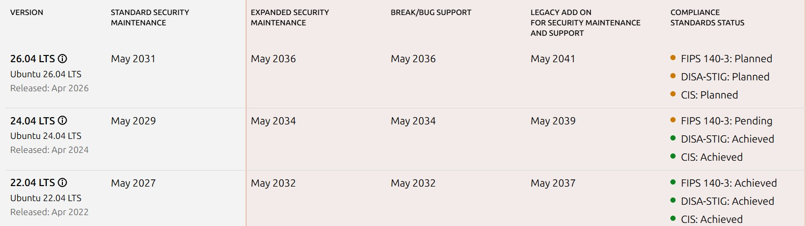
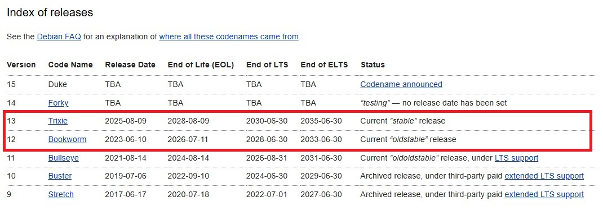

# Informasi Lengkap OS Linux yang Disediakan oleh Layanan VPS CloudKilat

Halo, Kawan Belajar!

Sistem operasi (OS) menentukan aplikasi apa saja yang bisa berjalan di VPS Anda dan berapa lama server tersebut tetap mendapat pembaruan keamanan. Karena itu, memilih distribusi dan versi yang tepat sebaiknya dilakukan sejak awal.

Artikel ini merangkum seluruh OS Linux yang tersedia pada layanan Kilat VPS (Kilat VM 2.0), lengkap dengan tanggal rilis, kernel bawaan, masa dukungan, serta kelebihan dan kekurangan setiap versi. Daftar OS di bawah berlaku untuk template Base OS, LAMP, dan LEMP. Data diperbarui per 13 November 2026.

## Pilihan OS di Kilat VPS

Template OS dapat dipilih pada dua kesempatan berikut:

1. Saat memesan layanan Kilat VPS, melalui pilihan VM Templates pada halaman konfigurasi detail pesanan. Langkah lengkapnya dapat dilihat pada artikel [Cara Memesan Layanan Kilat VM 2.0](https://kb.cloudkilat.id/pemesanan-layanan-domain/cara-memesan-layanan-kilat-vm-2-0).
2. Saat melakukan install ulang (reinstall), melalui tab Reinstallation pada halaman Manage layanan Kilat VM 2.0 di Portal Client. Langkah lengkapnya dapat dilihat pada artikel [Panduan Praktis: Cara Reinstall Layanan Kilat VM 2.0 Melalui Portal Client](https://kb.cloudkilat.id/pengelolaan-layanan/panduan-praktis-cara-reinstall-layanan-kilat-vm-2-0-melalui-portal-client).

Ringkasan versi yang tersedia beserta masa dukungannya:

| Distribusi | Versi | Tanggal rilis | Kernel bawaan | Dukungan utama hingga | Dukungan keamanan hingga |
|---|---|---|---|---|---|
| AlmaLinux | 8 | 30 Maret 2021 | 4.18 | 31 Mei 2024 (sudah berakhir) | 31 Mei 2029 |
| AlmaLinux | 9 | 26 Mei 2022 | 5.14 | 31 Mei 2027 | 31 Mei 2032 |
| AlmaLinux | 10 | 27 Mei 2025 | 6.12 | 31 Mei 2030 | 31 Mei 2035 |
| Ubuntu | 22.04 LTS | 21 April 2022 | 5.15 | Mei 2027 | Mei 2032 (Ubuntu Pro) |
| Ubuntu | 24.04 LTS | 25 April 2024 | 6.8 | Mei 2029 | Mei 2034 (Ubuntu Pro) |
| Ubuntu | 26.04 LTS | 23 April 2026 | 7.0 | Mei 2031 | Mei 2036 (Ubuntu Pro) |
| Debian | 12 | 10 Juni 2023 | 6.1 | 11 Juli 2026 (sudah berakhir) | 30 Juni 2028 (LTS) |
| Debian | 13 | 9 Agustus 2025 | 6.12 | 9 Agustus 2028 | 30 Juni 2030 (LTS) |
| Rocky Linux | 8 | 1 Mei 2021 | 4.18 | 31 Mei 2024 (sudah berakhir) | 31 Mei 2029 |
| Rocky Linux | 9 | 14 Juli 2022 | 5.14 | 31 Mei 2027 | 31 Mei 2032 |
| Rocky Linux | 10 | 11 Juni 2025 | 6.12 | 31 Mei 2030 | 31 Mei 2035 |
| CentOS Stream | 9 | Desember 2021 | 5.14 | 31 Mei 2027 | 31 Mei 2027 |
| CentOS Stream | 10 | 12 Desember 2024 | 6.12 | 31 Mei 2030 | 31 Mei 2030 |
| openSUSE Leap | 16.0 | 1 Oktober 2025 | 6.12 | Oktober 2027 | Oktober 2027 |

Keterangan kolom:

1. Dukungan utama adalah periode pembaruan penuh, berisi perbaikan bug dan keamanan. Istilah resminya berbeda di tiap distro: active support (AlmaLinux), general support (Rocky Linux), standard security maintenance (Ubuntu), dan regular support (Debian).
2. Dukungan keamanan adalah periode lanjutan yang hanya berisi pembaruan keamanan. Pada Ubuntu, periode ini (ESM) hanya tersedia melalui Ubuntu Pro. Pada Debian, periode ini ditangani oleh tim Debian LTS.
3. CentOS Stream dan openSUSE Leap tidak memiliki fase dukungan keamanan terpisah, sehingga kedua kolom berisi tanggal yang sama. Masa pemeliharaan openSUSE Leap 16.0 tercatat minimal hingga Oktober 2027.

## AlmaLinux

AlmaLinux adalah distribusi open source yang kompatibel secara biner dengan Red Hat Enterprise Linux (RHEL) dan dikelola oleh komunitas melalui AlmaLinux OS Foundation.

### AlmaLinux 8

Versi berbasis RHEL 8. Dukungan aktifnya berakhir 31 Mei 2024, sehingga saat ini AlmaLinux 8 hanya menerima pembaruan keamanan hingga 31 Mei 2029.

1. Kelebihan
    - Cocok untuk aplikasi atau panel kontrol yang masih membutuhkan basis RHEL 8.
    - Tetap aman dipakai karena pembaruan keamanan berjalan hingga 31 Mei 2029.
2. Kekurangan
    - Tidak lagi menerima pembaruan fitur.
    - Kernel 4.18 dan paket bawaannya sudah tertinggal dibandingkan versi 9 dan 10.

### AlmaLinux 9

Versi berbasis RHEL 9 dengan kernel 5.14.

1. Kelebihan
    - Matang, stabil, dan didukung luas oleh aplikasi pihak ketiga.
    - Menerima pembaruan keamanan hingga 31 Mei 2032.
2. Kekurangan
    - Dukungan aktif berakhir 31 Mei 2027. Setelah itu, versi ini hanya menerima pembaruan keamanan.

### AlmaLinux 10

Versi terbaru berbasis RHEL 10 dengan kernel 6.12.

1. Kelebihan
    - Masa dukungan terpanjang di keluarga AlmaLinux, yaitu pembaruan keamanan hingga 31 Mei 2035.
    - Menyediakan build x86_64_v2 untuk prosesor lama, berbeda dengan Rocky Linux 10 dan CentOS Stream 10 yang mensyaratkan prosesor x86-64-v3.
2. Kekurangan
    - Sebagian aplikasi atau panel kontrol pihak ketiga mungkin belum mendukung basis RHEL 10, jadi periksa kompatibilitasnya sebelum dipakai di server produksi.

*Gambar 1: Tabel rilis dan masa dukungan AlmaLinux 10, 9, dan 8*

## Ubuntu

Ubuntu adalah distribusi berbasis Debian yang dikembangkan oleh Canonical. Versi LTS (Long Term Support) dirilis setiap dua tahun dan mendapat dukungan standar selama 5 tahun. Setelah itu, pembaruan keamanan dapat dilanjutkan melalui Ubuntu Pro (ESM) hingga total 10 tahun, atau hingga 15 tahun dengan Legacy add-on.

### Ubuntu 22.04 LTS (Jammy Jellyfish)

Dirilis 21 April 2022 dengan kernel 5.15.

1. Kelebihan
    - Sangat matang, dengan dokumentasi dan dukungan aplikasi pihak ketiga yang luas.
2. Kekurangan
    - Dukungan standar berakhir Mei 2027. Setelah itu, pembaruan keamanan hanya tersedia melalui Ubuntu Pro, sehingga untuk server baru lebih disarankan memilih Ubuntu 24.04 atau 26.04.

### Ubuntu 24.04 LTS (Noble Numbat)

Dirilis 25 April 2024 dengan kernel 6.8.

1. Kelebihan
    - Seimbang antara stabilitas dan kebaruan paket, dengan dukungan standar hingga Mei 2029.
    - Banyak panduan di Basis Pengetahuan CloudKilat memakai versi ini, misalnya [Panduan Lengkap Install LEMP Stack (Nginx, MariaDB, PHP) di VPS Ubuntu 24.04](https://kb.cloudkilat.id/instalasi-dan-konfigurasi/panduan-lengkap-install-lemp-stack-nginx-maria-db-php-di-vps-ubuntu-24-04).
2. Kekurangan
    - Kernel dan paket bawaannya lebih lama dibandingkan Ubuntu 26.04.

### Ubuntu 26.04 LTS (Resolute Raccoon)

Dirilis 23 April 2026 dengan kernel 7.0.

1. Kelebihan
    - Kernel dan paket paling baru di antara versi LTS yang tersedia.
    - Dukungan standar terpanjang, yaitu hingga Mei 2031.
2. Kekurangan
    - Sebagian repositori pihak ketiga mungkin belum menyediakan paket untuk versi ini.
    - Implementasi sudo dan coreutils bawaan kini berbasis Rust (sudo-rs dan uutils), sehingga skrip lama sebaiknya diuji terlebih dahulu.

*Gambar 2: Masa dukungan Ubuntu 26.04 LTS, 24.04 LTS, dan 22.04 LTS*

## Debian

Debian adalah distribusi komunitas yang dikenal sangat stabil dan menjadi basis Ubuntu. Setiap rilis stabil Debian mendapat sekitar 3 tahun dukungan reguler, lalu 2 tahun dukungan LTS (Long Term Support).

### Debian 12 (Bookworm)

Dirilis 10 Juni 2023 dengan kernel 6.1. Dukungan regulernya berakhir 11 Juli 2026, dan pembaruan keamanannya kini ditangani tim Debian LTS hingga 30 Juni 2028.

1. Kelebihan
    - Stabil dan ringan.
    - Tetap menerima pembaruan keamanan hingga 30 Juni 2028.
2. Kekurangan
    - Fase LTS tidak mencakup semua paket dan arsitektur.
    - Debian sendiri menyarankan pengguna beralih ke Debian 13.

### Debian 13 (Trixie)

Rilis stabil terbaru Debian, dirilis 9 Agustus 2025 dengan kernel 6.12 LTS dan APT 3.0.

1. Kelebihan
    - Paket lebih baru dibandingkan Debian 12.
    - Dukungan reguler hingga 9 Agustus 2028 dan dukungan LTS hingga 30 Juni 2030.
2. Kekurangan
    - OpenSSH di versi ini tidak lagi mendukung kunci DSA. Jika Anda masih memakai kunci SSH berjenis DSA, ganti terlebih dahulu dengan jenis yang lebih baru seperti Ed25519.

*Gambar 3: Status dan masa dukungan Debian 13 dan Debian 12*

## Rocky Linux

Rocky Linux adalah distribusi enterprise yang kompatibel dengan RHEL dan dikembangkan oleh Rocky Enterprise Software Foundation sebagai penerus CentOS Linux.

### Rocky Linux 8 (Green Obsidian)

Versi berbasis RHEL 8 dengan kernel 4.18. Dukungan umumnya berakhir 31 Mei 2024, sehingga saat ini Rocky Linux 8 hanya menerima pembaruan keamanan hingga 31 Mei 2029.

1. Kelebihan
    - Cocok untuk aplikasi yang masih membutuhkan basis RHEL 8.
2. Kekurangan
    - Tidak lagi menerima pembaruan fitur.
    - Paket bawaannya sudah tertinggal dibandingkan versi 9 dan 10.

### Rocky Linux 9 (Blue Onyx)

Dirilis 14 Juli 2022 dengan kernel 5.14.

1. Kelebihan
    - Matang dan stabil, dengan pembaruan keamanan hingga 31 Mei 2032.
2. Kekurangan
    - Dukungan umum berakhir 31 Mei 2027. Setelah itu, versi ini hanya menerima pembaruan keamanan.

### Rocky Linux 10 (Red Quartz)

Dirilis 11 Juni 2025 dengan kernel 6.12.

1. Kelebihan
    - Masa dukungan terpanjang di keluarga Rocky Linux, yaitu pembaruan keamanan hingga 31 Mei 2035.
2. Kekurangan
    - Mensyaratkan prosesor x86-64-v3 dan tidak lagi menyertakan paket 32-bit.
    - Upgrade langsung dari Rocky Linux 8 atau 9 tidak didukung, sehingga perpindahan versi harus melalui instalasi baru.

*Gambar 4: Tabel rilis dan masa dukungan Rocky Linux 10, 9, dan 8*

## CentOS Stream

CentOS Stream berada di hulu (upstream) RHEL. Perubahan masuk ke CentOS Stream terlebih dahulu sebelum dirilis pada versi minor RHEL berikutnya. Masa hidup setiap versi CentOS Stream mengikuti berakhirnya fase full support RHEL versi yang sama.

### CentOS Stream 9

Dirilis Desember 2021 dengan kernel 5.14 dan berakhir pada 31 Mei 2027.

1. Kelebihan
    - Memberi akses lebih awal ke perubahan yang akan masuk ke RHEL 9, sehingga cocok untuk pengembangan dan pengujian.
2. Kekurangan
    - Tidak ada fase dukungan keamanan setelah 31 Mei 2027, sehingga untuk server baru lebih disarankan memilih CentOS Stream 10, AlmaLinux, atau Rocky Linux.

### CentOS Stream 10

Dirilis 12 Desember 2024 dengan kernel 6.12 dan berakhir pada 31 Mei 2030.

1. Kelebihan
    - Menjadi basis pengembangan RHEL 10, sehingga paketnya paling baru di keluarga RHEL.
2. Kekurangan
    - Mensyaratkan prosesor x86-64-v3.
    - Masa hidupnya lebih pendek dibandingkan AlmaLinux 10 dan Rocky Linux 10 yang didukung hingga 2035.

*Gambar 5: Tanggal end-of-life CentOS Stream 10 dan CentOS Stream 9*

## openSUSE Leap

openSUSE Leap adalah distribusi komunitas yang dibangun dari basis SUSE Linux Enterprise. Setiap rilis minor Leap 16 dipelihara selama 24 bulan, dan pengguna diharapkan pindah ke rilis minor terbaru dalam 12 bulan setelah rilis tersebut tersedia.

### openSUSE Leap 16.0

Dirilis 1 Oktober 2025 dengan kernel 6.12 LTS dan dipelihara minimal hingga Oktober 2027. Manajemen paket pada openSUSE Leap menggunakan zypper.

1. Kelebihan
    - Berbasis SUSE Linux Enterprise 16.
    - SELinux aktif secara bawaan.
    - Server dapat dikelola melalui antarmuka web Cockpit.
2. Kekurangan
    - Masa dukungan per rilis minor hanya 24 bulan, sehingga server perlu di-upgrade ke rilis minor berikutnya secara berkala.
    - Ekosistem panduan dan aplikasi pihak ketiganya tidak seluas Ubuntu, Debian, atau keluarga RHEL.

*Gambar 6: Masa pemeliharaan openSUSE Leap 16.0*

## Tips Memilih OS

1. Untuk server produksi baru yang membutuhkan masa dukungan panjang, pilih AlmaLinux 10 atau Rocky Linux 10 (pembaruan keamanan hingga 2035), Ubuntu 26.04 LTS (dukungan standar hingga 2031), atau Debian 13 (dukungan LTS hingga 2030).
2. Jika aplikasi atau panel kontrol yang akan dipasang hanya mendukung versi tertentu, ikuti daftar OS yang didukung oleh aplikasi tersebut. AlmaLinux 8 dan Rocky Linux 8 dapat dipakai untuk aplikasi lama yang membutuhkan basis RHEL 8.
3. Hindari memakai versi yang masa dukungannya akan segera berakhir untuk server baru, seperti Ubuntu 22.04 LTS (dukungan standar hingga Mei 2027), CentOS Stream 9 (hingga 31 Mei 2027), dan Debian 12 (sudah memasuki fase LTS).
4. CentOS Stream lebih cocok untuk pengembangan dan pengujian perubahan yang akan masuk ke RHEL berikutnya.
5. Mengganti OS pada Kilat VPS dilakukan melalui install ulang yang menghapus seluruh data di server. Pastikan data sudah di-backup sebelum memilih template baru.

## Kesimpulan

Kilat VPS kini menyediakan 14 versi OS dari enam distribusi Linux: AlmaLinux, Ubuntu, Debian, Rocky Linux, CentOS Stream, dan openSUSE Leap. Pilih versi berdasarkan kebutuhan aplikasi dan sisa masa dukungannya, lalu pantau tanggal akhir dukungan tersebut agar server tetap menerima pembaruan keamanan.

## Referensi

1. AlmaLinux: [wiki.almalinux.org/release-notes](https://wiki.almalinux.org/release-notes/)
2. Ubuntu: [ubuntu.com/about/release-cycle](https://ubuntu.com/about/release-cycle)
3. Debian: [debian.org/releases](https://www.debian.org/releases/)
4. Rocky Linux: [docs.rockylinux.org/releases](https://docs.rockylinux.org/releases/)
5. CentOS Stream: [centos.org/download](https://www.centos.org/download/)
6. openSUSE Leap: [en.opensuse.org/Lifetime](https://en.opensuse.org/Lifetime) dan [pengumuman rilis Leap 16.0](https://news.opensuse.org/2025/10/01/next-chapter-opens-with-leap-release/)